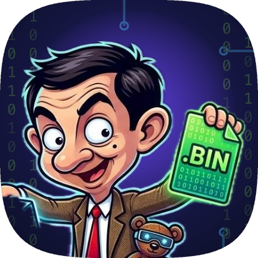
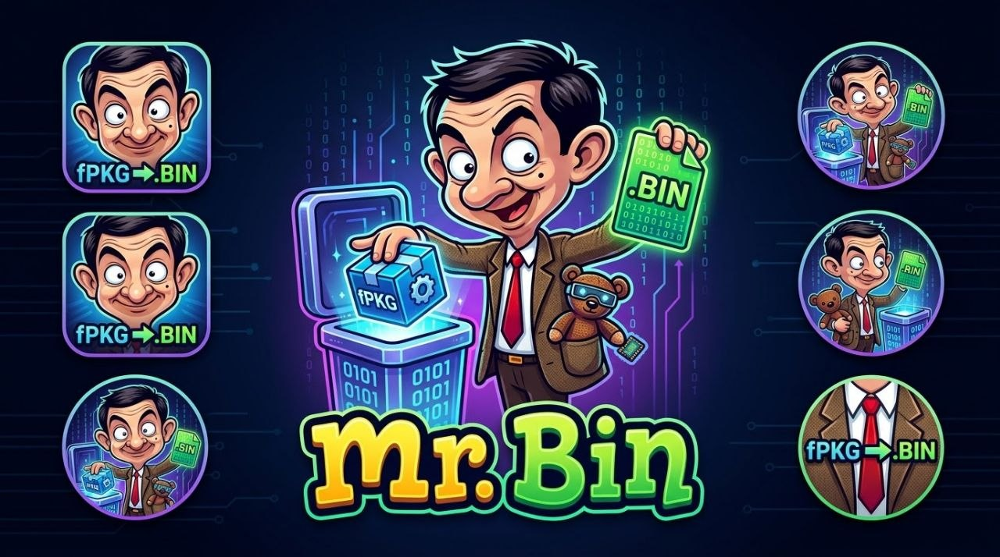

<p align="center"></p>

<h1 align="center">Mr. Bin</h1>

<p align="center"><i>PKG in, BIN out.</i></p>

<p align="center"><b>English</b> · <a href="README.es.md">Español</a></p>

<p align="center"></p>

Android app that unpacks a **PS4 fake PKG (fPKG)** into its game folder (`<game ID>/eboot.bin`, `sce_sys/`, `sce_module/` and the rest of the game) on the phone itself, no computer needed. It runs on any phone or tablet with **Android 11 or newer**, in English or Spanish.

Why the name: the app turns a `.pkg` into the folder that boots from `eboot.bin`, and Mr. Bin is the fussy gentleman in the tweed jacket who does it for you, one raised eyebrow at a time.

**Status:** 0.2.0 (what changed: [CHANGELOG](CHANGELOG.md)). The extraction engine was tested with a real game fPKG, compressed (PFSC) parts included, on a POCO F9 Ultra with HyperOS. Other phones have not been tested yet: if you try it on one, tell us how it went in an [issue](https://github.com/CodeWizardQA/mrbin/issues).

- Reads the `.pkg` files of a folder and says what each one is before touching anything: fPKG, store PKG, PS3 PKG, not a PKG, incomplete or damaged.
- Extracts the fPKGs you check, one after the other, in the background and with the screen off.
- Shows progress, speed and time left in the app, in the notification and, if you allow it, in a capsule next to the front camera.
- Pause, resume or cancel, also from the notification. Cancelling never leaves a half-written folder.
- Keeps a log of what it did, behind the small button at the top right, ready to copy or share.
- Never changes or deletes the `.pkg`: it only opens it for reading.
- **Never makes files up:** everything it writes comes out of the PKG. If it cannot open one, it says why and writes nothing.

## Install

1. Download `mrbin-X.Y.Z.apk` from the latest version in [Releases](https://github.com/CodeWizardQA/mrbin/releases). It is already built and signed: there is nothing to compile or sign.
2. Open it on the phone. Android asks the browser or file manager you open it with for permission to "install unknown apps", as with any APK that does not come from Google Play.
3. New versions install over the old one, without uninstalling, because they are all signed with the same key. To hear about new versions you can add this repository to [Obtainium](https://github.com/ImranR98/Obtainium).

### Check the APK

The official signing certificate has this SHA-256 (see it with `apksigner verify --print-certs` or with the AppVerifier app):

```
9325701afac386fd5a61ce7f506f2e44b5dd9c290e0a858fc3982e77c90334e8
```

## Use

1. The first screen lists three permissions. Only the first one is required: give the others if you want them and tap **Continue**. You can change any of them later with the key button at the top right.
   1. **File access** (required): "All files access", to read the `.pkg` and write the game folder.
   2. **No battery limit** (recommended): keeps the system (HyperOS, One UI, ColorOS…) from stopping the extraction of a big game with the screen off. On Xiaomi / HyperOS the phone opens its own battery page: choose **No restrictions**.
   3. **Display over other apps** (optional): the capsule with the percentage next to the front camera. Phones without a camera cutout show it at the top center. Since Android 11 the system opens the list of all apps: find Mr. Bin in it and turn it on.
2. In **Extract**, choose the folder with the `.pkg` (`Download` by default) and the destination folder (`Download/MrBin` by default).
3. Check the PKGs marked **fPKG** and tap **Extract** in the bar at the bottom. While it runs, the progress card at the top has **Pause** and **Cancel**.
4. When it finishes, **Results** says where each game went, how many files and bytes it wrote, the size and first bytes of `eboot.bin`, and what it did not write.

If something fails, take a screenshot of the message in **Results** and copy the log (button at the top right → **Copy**). The log is always in English so anyone can read it in an issue. It is also in the app's private folder (`files/log.txt`).

### What ends up in the destination

```
Download/MrBin/CUSA01623/
  eboot.bin           the game executable (PS4 SELF), as it comes in the PKG
  sce_module/         game libraries (.prx)
  sce_sys/            param.sfo, icon0.png, playgo-chunk.dat, … (the named PKG entries)
  …                   the rest of the game's folders and files
```

- The folder is named after the game ID (`CUSA01623`). If the PKG has no valid ID, it uses the Content ID.
- It writes into `<ID>.partial` first and renames it only when everything is complete. On an error or a cancel, it deletes it.
- Before starting it checks there is room for the whole game plus 64 MB. If a non-empty folder with that name already exists, it stops and leaves it alone.

### Language

The app follows the phone's language: Spanish on phones in Spanish, English everywhere else. On Android 13 and newer you can also pick it per app in **Settings → Apps → Mr. Bin → Language**. Texts live in `app/src/main/res/values/strings.xml` (English) and `values-es/strings.xml` (Spanish); a new language is one more `values-xx/strings.xml`.

## What it cannot do

- **Store PKGs (PlayStation Store).** Their image key depends on the account license, which only the console decrypts. The app marks them as **STORE** and writes nothing. No phone or computer app can open them: you need a dump made on a PS4 with homebrew that holds that license.
- **PS3 PKGs.** It recognizes them (`\x7FPKG`) and marks them as not supported.
- **`sce_sys` files encrypted with console keys** (for example `license.info`, key 2). They are not written, and Results lists them.

## How the engine works

`app/src/main/java/io/github/codewizardqa/mrbin/engine/orbis/` is a Java translation of two well-known extractors:

- **shadPS4 `v.0.7.0`** (commit `3b2c01272383e1fcd0b82c7873e1ebf1a641aada`): `src/core/file_format/pkg.cpp`, `pkg.h`, `pfs.h`, `pkg_type.cpp`, `src/core/crypto/crypto.cpp` and `keys.h`.
- **LibOrbisPkg** (commit `643477263b2644e0803e0f58b8726ea4e3f3b7d4`): `PKG/Pkg.cs`, `PFS/PfsReader.cs`, `PFS/PFSCReader.cs`, `PFS/XtsDecryptReader.cs` and `PFS/PfsStructs.cs`.

The steps:

1. Read the PKG header and entry table, and check the file is complete.
2. Decrypt dk3 with the public `PkgDerivedKey3` keyset.
3. With dk3, get the image key, and with it the EKPFS using the public fPKG keyset.
4. Derive the XTS keys from the PFS seed.
5. Decrypt the outer PFS and find `pfs_image.dat`.
6. Decompress it (PFSC) and open the inner PFS.
7. Write every file under `uroot`.
8. Write the named PKG entries to `sce_sys/`, as shadPS4 does.

A store PKG fails at step 2 or 3: that is what the app shows as **STORE**.

| File | What it does |
| --- | --- |
| `OrbisPkg.java` | Public entry: `inspect()` (writes nothing) and `extract()` |
| `PkgFile.java` | PKG header, entry table and keys |
| `PfsImage.java` | PFS reader: header, inodes and directories |
| `Source.java` | Ranged reads: file, slice, blocks, XTS and PFSC |
| `OrbisCrypto.java` | RSA, SHA-256, HMAC, AES-CBC and the PFS XTS keys |
| `OrbisKeys.java` | Public fPKG keys (generated, see below) |
| `PkgEntryNames.java` | Name of every PKG entry, 611 in total (generated) |
| `Sfo.java` | Reads `param.sfo`: title, ID, category, version |
| `Le.java` | Little-endian reads |

The rest of the app:

| File | What it does |
| --- | --- |
| `engine/PkgConverterEngine.java` | Finds the `.pkg` files, extracts them in a batch on a worker thread and keeps the log |
| `engine/PkgModels.java` | State shown by the app and the notification |
| `engine/SettingsStore.java` | Source and destination folders, and whether the first-start screen is done |
| `service/ConversionService.java` | Foreground service: progress notification, wake lock and the camera capsule |
| `service/ConversionActionReceiver.java` | Notification buttons (pause/resume, cancel) |
| `ui/MainActivity.java` | Extract and Results tabs, the log page and the permissions page |
| `ui/FolderPickerDialogs.java` | Folder picker |
| `ui/Palette.java` | Every color of the app |
| `ui/Texts.java` | Engine states and reasons in the phone's language |
| `ui/Icons.java` | Interface icons, drawn in code (Mr. Bin's face is `res/drawable-nodpi/ic_glyph.png`) |
| `App.java` | Creates the engine and the log file, reads the APK version |

The app is plain Java, without AndroidX, Kotlin or Gradle. It runs from Android 11 (API 30) and targets API 34.

## Project layout

```
app/
  src/main/                  the app (AndroidManifest.xml, java/, res/)
  src/test/…/OrbisCli.java   runs the engine on a computer, without Android
art/
  source/                    the Mr. Bin artwork and the mask that lifts him out of it
  icon.py                    cuts every icon from the artwork (adaptive layers, monochrome, in-app glyph)
  lift.swift                 makes that mask again with the subject lifting of macOS
docs/icon.png                the icon for this README
scripts/
  build-apk.sh               builds and signs the APK
  test-engine.sh             runs the engine on a computer (keys / inspect / extract)
  compare-tree.sh            compares an extraction with another tool's, by SHA-256
tools/
  gen_names.py               generates PkgEntryNames.java from shadPS4's pkg_type.cpp
  emit_keys.py               generates OrbisKeys.java from shadPS4's keys.h (uses keys2java.py)
CHANGELOG.md                 changes per version
LICENSE                      GPL-3.0
```

## Build

Requirements on a Mac, from Homebrew: `android-commandlinetools` with `build-tools;34.0.0` and `platforms;android-34` (in `/opt/homebrew/share/android-commandlinetools`, or set `ANDROID_SDK_DIR`), `openjdk` and `python3`.

```bash
scripts/build-apk.sh
```

It works from any folder and leaves `mrbin-X.Y.Z.apk` in `app/build/outputs/apk/release/` plus a copy at the repository root (git ignores `.apk` files). The steps are `aapt2` → `javac` → `d8` → `zipalign` → `apksigner`.

**New version:** change it only in `scripts/build-apk.sh` (`VERSION_CODE` and `VERSION_NAME`). The app reads it from the APK for the header and the log. `VERSION_CODE` must always go up: Android does not install a lower one over a higher one.

**Icon:** every icon comes from the artwork in `art/source/mrbin-art.jpg`. Change the framing in `art/icon.py` and run `python3 art/icon.py` (needs Pillow): it writes the layers `res/mipmap-*dpi/ic_launcher_*.png`, `res/drawable-nodpi/ic_glyph.png` (Mr. Bin's face on the Extract tab), `docs/icon.png` and a preview in `art/out/`. Those files are not edited by hand. If the artwork changes, make the mask again with `swift art/lift.swift art/source/mrbin-art.jpg art/source/mrbin-mask.png` (macOS 14 or newer). The notification icon, `res/drawable/ic_stat_app.xml`, is a line drawing edited by hand, because the artwork turns into a blob at 24 dp.

### Signing

Official versions are signed with the Mr. Bin key (alias `mrbin`). The key lives outside the repository and its password in the macOS Keychain; the script hands the password to `apksigner` through standard input, never on the command line, and then checks the certificate is the official one. If the key is missing it stops instead of creating another, because Android does not update an app signed with a different key.

**If you build your own version**, sign it with your own key:

```bash
keytool -genkeypair -keystore ~/my-key.p12 -storetype PKCS12 -alias myalias -keyalg RSA -keysize 4096 -validity 10000
security add-generic-password -s my-mrbin -a myalias -w          # asks for the key password
RELEASE_KEYSTORE=~/my-key.p12 RELEASE_KEY_ALIAS=myalias RELEASE_KEYCHAIN_SERVICE=my-mrbin scripts/build-apk.sh
```

Your APK does not install over the official one (nor the other way round), because the signatures differ.

## Test the engine on a computer

```bash
scripts/test-engine.sh keys                         # checks the RSA keysets are consistent
scripts/test-engine.sh inspect game.pkg             # what the app would say about that PKG
scripts/test-engine.sh extract game.pkg /tmp/out    # extracts like the app does, into /tmp/out/<ID>/
scripts/compare-tree.sh <reference>/uroot /tmp/out/<ID>
```

For a reference to compare against, extract the same PKG with LibOrbisPkg's `PkgTool pkg_extract` (.NET). With the Apollo Save Tool fPKG (`IV0000-APOL00004_00-APOLLO0000000PS4`) all 100 files came out identical by SHA-256 to `PkgTool pkg_extract`'s, and the `sce_sys` entries identical to `pkg_extractentry`'s. Apollo has no compressed (PFSC) parts; that part was checked on the phone with a real game fPKG.

## Regenerate the tables

`PkgEntryNames.java` and `OrbisKeys.java` are not edited by hand. They are generated from a shadPS4 clone at tag `v.0.7.0`:

```bash
python3 -I tools/gen_names.py <shadPS4>/src/core/file_format/pkg_type.cpp app/src/main/java/io/github/codewizardqa/mrbin/engine/orbis/PkgEntryNames.java
python3 -I tools/emit_keys.py <shadPS4>/src/core/crypto/keys.h > app/src/main/java/io/github/codewizardqa/mrbin/engine/orbis/OrbisKeys.java
```

With `v.0.7.0`, both come out identical to the ones in the repository.

## Next

- PS3 PKG support.
- Tests on more phones.
- More languages (Portuguese first).

## License and credits

Mr. Bin is free software under the **GNU GPL version 3 or later** (`GPL-3.0-or-later`); the full text is in [LICENSE](LICENSE). You can use, copy, change and share it, as long as what you share is also under the GPL and comes with its source code.

The engine (`engine/orbis/`) is a translation of code from:

- [**shadPS4**](https://github.com/shadps4-emu/shadPS4), Copyright 2024 shadPS4 Emulator Project, under **GPL-2.0-or-later**.
- [**LibOrbisPkg**](https://github.com/maxton/LibOrbisPkg), by Maxton, under **LGPL-3.0**.

Both licenses allow distributing the result under GPL-3.0. Every engine file carries the matching notice.

The keys in `OrbisKeys.java` are the same public fPKG keys that ship with shadPS4 and LibOrbisPkg. They only open fPKGs.

**Disclaimer:** Mr. Bin is an independent project, not affiliated with Sony Interactive Entertainment. "PlayStation" and "PS4" are trademarks of Sony. Mr. Bin does not break any protection of store PKGs: it is for fPKGs, homebrew and backups of your own games.
